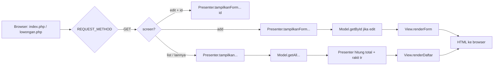
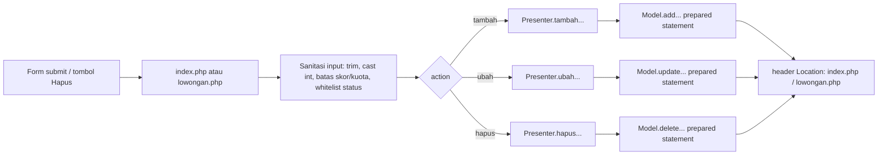

# Janji
Saya Afit Fajar Rianto dengan NIM 2501826 mengerjakan Tugas Praktikum 9 dalam mata kuliah Desain dan Pemrograman Berorientasi Objek (DPBO) untuk keberkahan-Nya, maka saya tidak melakukan kecurangan seperti yang telah dispesifikasikan. Aamiin.

Proyek ini merupakan implementasi arsitektur **Model-View-Presenter (MVP)** dengan pendekatan **Strict Passive View**. Pada proyek ini, saya menambahkan modul **Lowongan Kerja** bertema rekrutmen/HR dengan fitur CRUD lengkap.

---

## Struktur Repository

```text
TP9DPBO2526C2/
├── project/
│   ├── index.php                       # Entry point modul Kandidat
│   ├── lowongan.php                    # Entry point modul Lowongan
│   ├── models/
│   │   ├── DB.php                      # Koneksi & helper PDO (executeQuery, getAllResult)
│   │   ├── Kandidat.php                # Entity kandidat
│   │   ├── Lowongan.php                # Entity lowongan
│   │   ├── KontrakModel.php            # Kontrak Model kandidat
│   │   ├── KontrakModelLowongan.php    # Kontrak Model lowongan
│   │   ├── TabelKandidat.php           # Implementasi Model kandidat
│   │   └── TabelLowongan.php           # Implementasi Model lowongan
│   ├── presenters/
│   │   ├── KontrakPresenter.php
│   │   ├── KontrakPresenterLowongan.php
│   │   ├── PresenterKandidat.php
│   │   └── PresenterLowongan.php
│   ├── views/
│   │   ├── KontrakView.php
│   │   ├── KontrakViewLowongan.php
│   │   ├── ViewKandidat.php
│   │   └── ViewLowongan.php
│   └── template/
│       ├── skin.html                   # Template tabel kandidat
│       ├── form.html                   # Template form kandidat
│       ├── lowongan_skin.html          # Template tabel lowongan
│       └── lowongan_form.html          # Template form lowongan
├── dokumentasi/
│   ├── README.md                       # Panduan & placeholder screenrecord
│   ├── screenrecord_kandidat.mp4       # [belum diunggah]
│   └── screenrecord_lowongan.mp4       # [belum diunggah]
├── mvp_db.sql                          # Export terbaru: kandidat + lowongan
└── README.md                           # File ini
```

---

## Desain Program

### Arsitektur MVP Strict Passive View

| Komponen | Tanggung jawab di proyek ini |
|---|---|
| **Model** (`TabelKandidat`, `TabelLowongan`) | Mengelola database: `SELECT`, `INSERT`, `UPDATE`, `DELETE` dengan **prepared statement**. Mengembalikan array objek Entity. Tidak pernah dipanggil langsung oleh View. |
| **View** (`ViewKandidat`, `ViewLowongan`) | Membaca file HTML template dan mengganti token seperti `{{TABLE_ROWS}}`, `{{TOTAL_DATA}}`, `{{FORM_TITLE}}`. **Tidak ada `foreach`, `count()`, `require_once` Entity/Model.** |
| **Presenter** (`PresenterKandidat`, `PresenterLowongan`) | Penghubung Model ↔ View. Menjalankan logika tampilan, menghitung total data, **merakit potongan baris `<tr>`**, menyiapkan data form (*prefill*), lalu memanggil View. Juga menangani aksi CRUD dan redirect. |

Perbedaan dengan MVP standar: pada modul ini Presenter sengaja ikut merakit HTML baris tabel agar View tetap **100% pasif** tanpa menambah library. Ini sesuai penjelasan modul mengenai *Strict Passive View*.

### Interface / Kontrak

Setiap modul menggunakan tiga kontrak sehingga komponen bisa diuji dan dikembangkan terpisah:

- `KontrakModel`, `KontrakView`, `KontrakPresenter` → modul **Kandidat**
- `KontrakModelLowongan`, `KontrakViewLowongan`, `KontrakPresenterLowongan` → modul **Lowongan**

Constructor Presenter menerima kontrak, bukan implementasi konkret:

```php
public function __construct(KontrakModel $model, KontrakView $view)
public function __construct(KontrakModelLowongan $model, KontrakViewLowongan $view)
```

### Database

Database: `mvp_kandidat_db` (lihat `mvp_db.sql`).

**Tabel `kandidat`**

| Kolom | Tipe | Keterangan |
|---|---|---|
| `id` | int, AUTO_INCREMENT | Primary key |
| `nama` | varchar(100) | Nama kandidat |
| `posisi` | varchar(100) | Posisi dilamar |
| `domisili` | varchar(100) | Domisili |
| `skorTes` | int | 0–100, dipakai untuk sorting |
| `pengalamanTahun` | int | Pengalaman kerja |

**Tabel `lowongan`** (tabel tambahan)

| Kolom | Tipe | Keterangan |
|---|---|---|
| `id` | int, AUTO_INCREMENT | Primary key |
| `judul` | varchar(150) | Judul lowongan |
| `departemen` | varchar(100) | Departemen |
| `lokasi` | varchar(100) | Lokasi |
| `jenis` | varchar(50) | Full-time / Part-time / Contract / Internship |
| `kuota` | int | Jumlah kuota, minimal 1 |
| `status` | varchar(20) | `Buka` / `Ditutup` |

Data awal menggunakan `INSERT IGNORE`, sehingga `mvp_db.sql` **aman di-import ulang**. Tidak ada foreign key/JOIN — sesuai modul, relasi bersifat opsional.

---

## Alur Program

### Alur GET (menampilkan halaman)



### Alur POST (Create / Update / Delete)



Diagram di atas merupakan ringkasan visual; alur programnya dijelaskan lebih lengkap berikut ini.

**Saat halaman dibuka (GET):** browser mengakses `index.php` untuk modul Kandidat atau `lowongan.php` untuk modul Lowongan. Entry point memeriksa parameter halaman, lalu meneruskan permintaan ke Presenter yang sesuai. Untuk halaman daftar, Presenter meminta data kepada Model, menghitung jumlah data, dan menyiapkan baris tabel. View kemudian mengisi token pada template dengan data yang disiapkan Presenter dan mengirimkan HTML ke browser. Untuk formulir tambah, Presenter menampilkan formulir kosong. Untuk formulir ubah, Presenter meminta data berdasarkan ID kepada Model dan mengirimkannya ke View sebagai *prefill*. Jika data dengan ID tersebut tidak ditemukan, pengguna diarahkan kembali ke halaman daftar.

**Saat formulir dikirim (POST):** entry point membersihkan dan memvalidasi input, kemudian memilih aksi tambah, ubah, atau hapus berdasarkan parameter permintaan. Presenter meneruskan aksi tersebut ke Model yang menjalankan operasi database menggunakan *prepared statement*. Setelah operasi selesai, pengguna diarahkan kembali ke halaman modul terkait agar dapat melihat daftar data terbaru.

---
## Dokumentasi

https://github.com/user-attachments/assets/2f502b25-80f1-4dad-95ff-7f7feac17628

