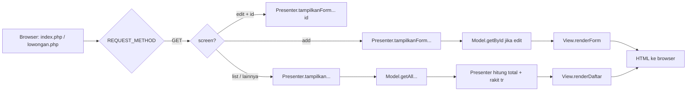
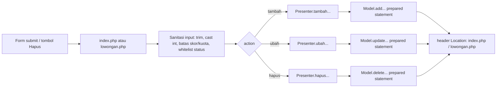

# Praktikum DPBO — Modul 10: Model-View-Presenter (MVP)

**Nama:** `[Nama Anda]`  
**NIM:** `[NIM Anda]`  
**Kelas:** `[Kelas Anda]`  
**Repository:** `TP9DPBO2526C2`

Proyek ini merupakan implementasi arsitektur **Model-View-Presenter (MVP)** dengan pendekatan **Strict Passive View** untuk dua modul:

1. **Kandidat Karyawan** — modul latihan dari starter (Read + Form + CRUD lengkap).
2. **Lowongan Kerja** — modul tambahan bertema rekrutmen/HR sesuai tugas praktikum (CRUD lengkap).

---

## Struktur Repository

```text
TP9DPBO2526C2/
├── project/
│   ├── index.php                       # Entry point modul Kandidat
│   ├── lowongan.php                    # Entry point modul Lowongan
│   ├── models/
│   │   ├── DB.php                      # Koneksi & helper PDO (executeQuery, getAllResult)
│   │   ├── Kandidat.php                # Entity kandidat
│   │   ├── Lowongan.php                # Entity lowongan
│   │   ├── KontrakModel.php            # Kontrak Model kandidat
│   │   ├── KontrakModelLowongan.php    # Kontrak Model lowongan
│   │   ├── TabelKandidat.php           # Implementasi Model kandidat
│   │   └── TabelLowongan.php           # Implementasi Model lowongan
│   ├── presenters/
│   │   ├── KontrakPresenter.php
│   │   ├── KontrakPresenterLowongan.php
│   │   ├── PresenterKandidat.php
│   │   └── PresenterLowongan.php
│   ├── views/
│   │   ├── KontrakView.php
│   │   ├── KontrakViewLowongan.php
│   │   ├── ViewKandidat.php
│   │   └── ViewLowongan.php
│   └── template/
│       ├── skin.html                   # Template tabel kandidat
│       ├── form.html                   # Template form kandidat
│       ├── lowongan_skin.html          # Template tabel lowongan
│       └── lowongan_form.html          # Template form lowongan
├── dokumentasi/
│   ├── README.md                       # Panduan & placeholder screenrecord
│   ├── screenrecord_kandidat.mp4       # [belum diunggah]
│   └── screenrecord_lowongan.mp4       # [belum diunggah]
├── mvp_db.sql                          # Export terbaru: kandidat + lowongan
└── README.md                           # File ini
```

---

## Desain Program

### Arsitektur MVP Strict Passive View

| Komponen | Tanggung jawab di proyek ini |
|---|---|
| **Model** (`TabelKandidat`, `TabelLowongan`) | Mengelola database: `SELECT`, `INSERT`, `UPDATE`, `DELETE` dengan **prepared statement**. Mengembalikan array objek Entity. Tidak pernah dipanggil langsung oleh View. |
| **View** (`ViewKandidat`, `ViewLowongan`) | Membaca file HTML template dan mengganti token seperti `{{TABLE_ROWS}}`, `{{TOTAL_DATA}}`, `{{FORM_TITLE}}`. **Tidak ada `foreach`, `count()`, `require_once` Entity/Model.** |
| **Presenter** (`PresenterKandidat`, `PresenterLowongan`) | Penghubung Model ↔ View. Menjalankan logika tampilan, menghitung total data, **merakit potongan baris `<tr>`**, menyiapkan data form (*prefill*), lalu memanggil View. Juga menangani aksi CRUD dan redirect. |

Perbedaan dengan MVP standar: pada modul ini Presenter sengaja ikut merakit HTML baris tabel agar View tetap **100% pasif** tanpa menambah library. Ini sesuai penjelasan modul mengenai *Strict Passive View*.

### Interface / Kontrak

Setiap modul menggunakan tiga kontrak sehingga komponen bisa diuji dan dikembangkan terpisah:

- `KontrakModel`, `KontrakView`, `KontrakPresenter` → modul **Kandidat**
- `KontrakModelLowongan`, `KontrakViewLowongan`, `KontrakPresenterLowongan` → modul **Lowongan**

Constructor Presenter menerima kontrak, bukan implementasi konkret:

```php
public function __construct(KontrakModel $model, KontrakView $view)
public function __construct(KontrakModelLowongan $model, KontrakViewLowongan $view)
```

### Database

Database: `mvp_kandidat_db` (lihat `mvp_db.sql`).

**Tabel `kandidat`**

| Kolom | Tipe | Keterangan |
|---|---|---|
| `id` | int, AUTO_INCREMENT | Primary key |
| `nama` | varchar(100) | Nama kandidat |
| `posisi` | varchar(100) | Posisi dilamar |
| `domisili` | varchar(100) | Domisili |
| `skorTes` | int | 0–100, dipakai untuk sorting |
| `pengalamanTahun` | int | Pengalaman kerja |

**Tabel `lowongan`** (tabel tambahan)

| Kolom | Tipe | Keterangan |
|---|---|---|
| `id` | int, AUTO_INCREMENT | Primary key |
| `judul` | varchar(150) | Judul lowongan |
| `departemen` | varchar(100) | Departemen |
| `lokasi` | varchar(100) | Lokasi |
| `jenis` | varchar(50) | Full-time / Part-time / Contract / Internship |
| `kuota` | int | Jumlah kuota, minimal 1 |
| `status` | varchar(20) | `Buka` / `Ditutup` |

Data awal menggunakan `INSERT IGNORE`, sehingga `mvp_db.sql` **aman di-import ulang**. Tidak ada foreign key/JOIN — sesuai modul, relasi bersifat opsional.

---

## Alur Program

### Alur GET (menampilkan halaman)



### Alur POST (Create / Update / Delete)



### Penjelasan singkat alur
1. **GET list** → Presenter meminta semua data ke Model → menghitung total → merakit baris tabel → View mengganti token → HTML dikirim ke browser.
2. **GET add** → Presenter langsung memanggil `renderForm(..., 'tambah', [])` tanpa data.
3. **GET edit** → Presenter mengambil data by ID, lalu mengirim `$formData` ke View supaya form terisi (*prefill*). Jika ID tidak ditemukan, redirect ke halaman daftar.
4. **POST** → `index.php` / `lowongan.php` membersihkan input, memilih aksi, memanggil method Presenter, lalu Presenter memerintahkan Model dan redirect.

---

## Daftar Fitur

### Modul Kandidat
- [x] Read: tabel diurutkan dari `skorTes` tertinggi
- [x] Total kandidat dihitung Presenter
- [x] Form Tambah dengan validasi sisi server
- [x] Form Ubah dengan prefill data
- [x] Hapus dengan konfirmasi
- [x] Prepared statement pada seluruh query

### Modul Lowongan (tambahan)
- [x] Tabel daftar lowongan dengan badge status
- [x] Total lowongan dihitung Presenter
- [x] Form Tambah dengan validasi (`kuota ≥ 1`, status dibatasi `Buka`/`Ditutup`)
- [x] Form Ubah dengan prefill data
- [x] Hapus dengan konfirmasi
- [x] Navigasi silang ke modul kandidat
- [x] Prepared statement pada seluruh query

---

## Cara Menjalankan

1. Salin folder `TP9DPBO2526C2` ke `C:\xampp\htdocs\` (XAMPP) atau `C:\laragon\www\` (Laragon).
2. Nyalakan **Apache** dan **MySQL**.
3. Buka `http://localhost/phpmyadmin`, lalu import **`mvp_db.sql`** dari root repository.
   - Akan terbentuk database `mvp_kandidat_db` dengan tabel `kandidat` dan `lowongan`.
4. Akses aplikasi:
   - Kandidat: `http://localhost/TP9DPBO2526C2/project/index.php`
   - Lowongan: `http://localhost/TP9DPBO2526C2/project/lowongan.php`

> Kredensial default di kode: host `localhost`, user `root`, password kosong, database `mvp_kandidat_db`. Sesuaikan di `project/index.php` dan `project/lowongan.php` bila konfigurasi MySQL Anda berbeda.

---

## Kepatuhan Strict Passive View

- [x] Tidak ada `foreach` di folder `project/views/`
- [x] Tidak ada `count()` di folder `project/views/`
- [x] Tidak ada `require_once` Model/Entity di folder `project/views/` (hanya kontrak View)
- [x] View hanya melakukan penggantian token `str_replace()`
- [x] Presenter yang merakit `<tr>...</tr>`
- [x] Seluruh komunikasi memakai interface/kontrak
- [x] Entity tidak pernah dikirim langsung ke View

---

## Dokumentasi Screenrecord

Letakkan video di folder `dokumentasi/` mengikuti panduan `dokumentasi/README.md`.

| Video | Status | Tautan |
|---|---|---|
| `screenrecord_kandidat.mp4` | Belum diunggah | `dokumentasi/screenrecord_kandidat.mp4` |
| `screenrecord_lowongan.mp4` | Belum diunggah | `dokumentasi/screenrecord_lowongan.mp4` |

---

## Pengumpulan

1. Pastikan repository bersifat **public** di GitHub.
2. Commit seluruh struktur di atas, termasuk `mvp_db.sql` terbaru dan video dokumentasi.
3. Submit ke Google Form: https://forms.gle/hpBcpRtUHUGJfWfX7
4. **Deadline: 27/11/2026 23:59:59.**

---

## Daftar Pustaka

- Tim Asisten Praktikum Desain dan Pemrograman Berbasis Objek Angkatan 15 (2023). *Modul 10: MVP*.
- GeeksForGeeks (2025). *MVP (Model View Presenter) Architecture Pattern in Android with Example*. https://www.geeksforgeeks.org/android/mvp-model-view-presenter-architecture-pattern-in-android-with-example/
